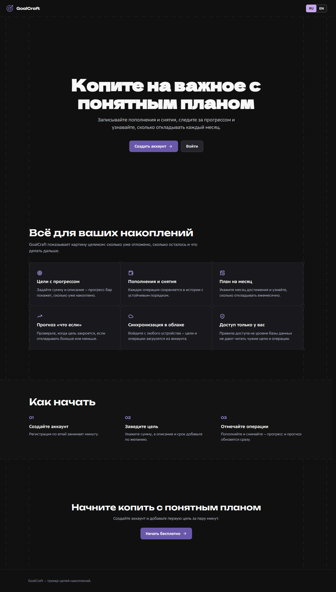
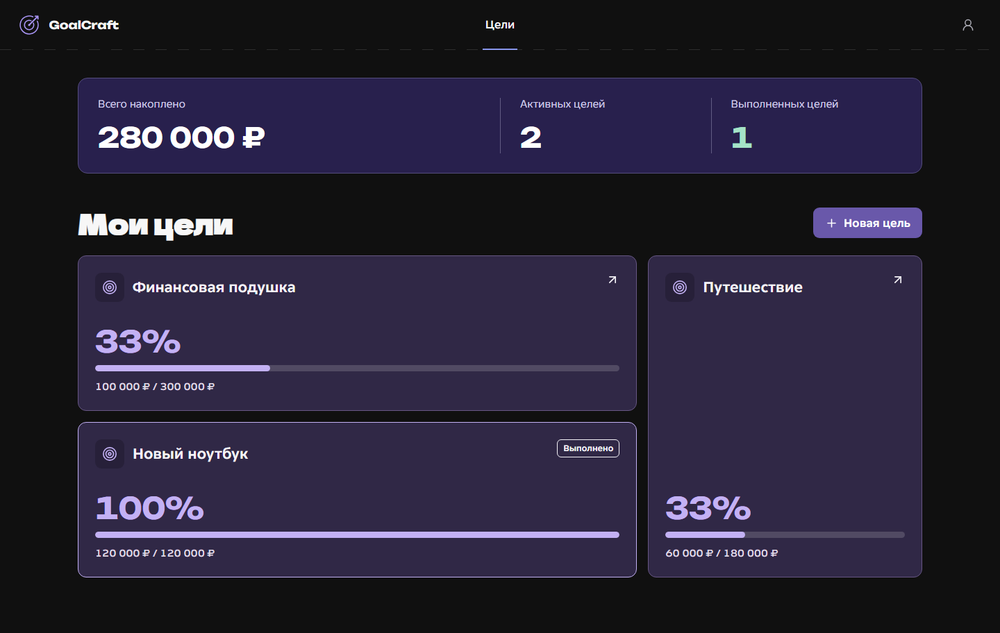
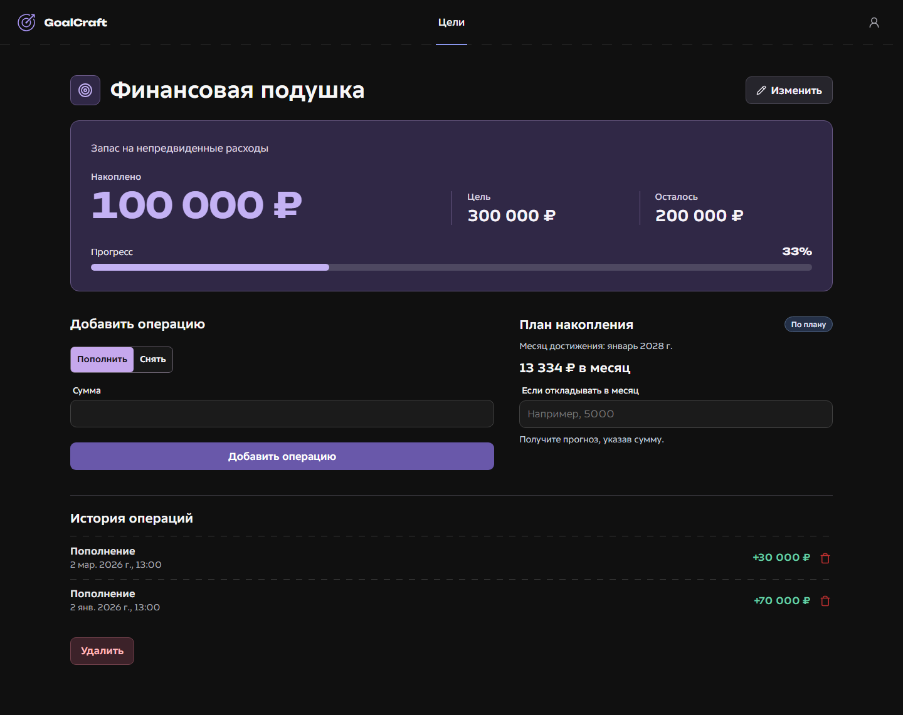
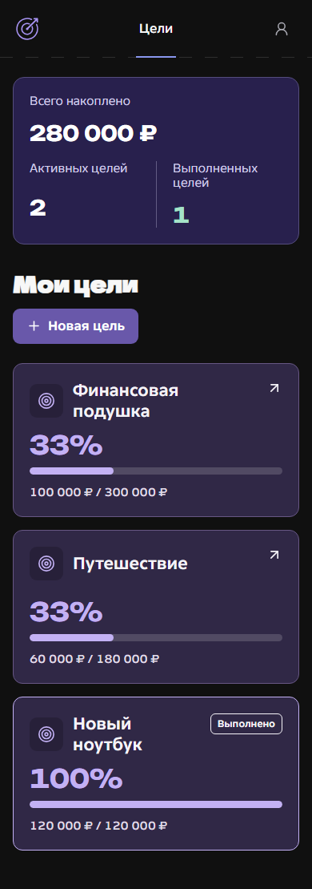
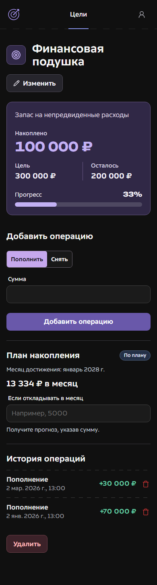

# GoalCraft

[Русская версия](README.ru.md)

A bilingual savings goal tracker built with React and TypeScript. Create an email account to sync goals and transactions through Supabase. Each goal uses whole rubles or US dollars.

## Screenshots

### Desktop







### Mobile






## Features

- Multiple goals with deposits, withdrawals, progress, and ordered transaction history. The goal page shows saved, target, and remaining amounts alongside separate operation, plan, and history sections.
- Choose a preset color and icon for each goal; appearance follows the goal across devices.
- Choose RUB or USD for each goal. Overview totals stay separate by currency; amounts are not converted.
- An optional target month and required contribution: `ceil(remaining / months including the current and target months)`.
- A what-if calculator forecasts the completion month for a chosen monthly contribution. Completed and overdue goals have distinct states.
- A local demo with example goals remains available to browsers that previously selected it; the welcome page no longer offers a new demo entry. Demo data stays in browser storage and is never uploaded automatically.
- Supabase Auth for email/password registration, confirmation, sign-in, and password recovery. Postgres is the source of truth for an account.
- Russian and English UI with a saved language choice.
- A user profile with account details, language and sign-out settings, currency-separated totals, six-month savings and cash-flow charts, and goal progress. The language selected on the welcome page carries over to the profile.

## Architecture and tradeoffs

The app uses React 19, TypeScript, React Router, Redux Toolkit, CSS Modules, Jest, and Playwright. The same goal and transaction components render both modes. The demo store persists to `goal-tracker-demo-state`; legacy local data in `goal-tracker-state` is copied into the demo on first entry without changing the original. The cloud store never persists its ledger to browser storage. After a mutation, tab focus, or reconnect, it reloads the account's ledger from Postgres.

Cloud tables use owner-only SELECT policies. Direct client writes are revoked; five authenticated RPCs create/update/delete goals and add/delete transactions. A separate `get_ledger()` function reads both tables in one snapshot and returns the complete ledger as one object. Transactions have an explicit `position`, so order does not depend on timestamps. Each balance-changing RPC locks its goal row and validates the ordered history. Updating `ledger_version` makes a competing `REPEATABLE READ` writer fail with a serialization conflict instead of accepting a stale balance. The browser also checks common invalid actions, while the server remains authoritative.

The cloud client reloads a small complete ledger after each change instead of using realtime subscriptions or optimistic writes. This simplifies consistency and error recovery, but very large histories would need pagination. Amounts are integer RUB or USD; fractional currency and exchange rates are out of scope. Existing goals without a currency use RUB. Local data is deliberately separate from cloud accounts. A paused Supabase Free project affects accounts, while the static demo remains usable.

## Project documentation

- [Contributing](CONTRIBUTING.md): Git workflow and checks.
- [Product roadmap](docs/product-roadmap.md) (Russian): proposals and remaining work, not a product specification.
- `docs/superpowers/`: historical plans and designs; consult the code and this README for current behavior.

## Run locally

Node.js 22.11 or newer is required.

```sh
npm ci
npm start
```

Open `http://localhost:3000`. The app boots without environment values; for cloud accounts, copy `.env.example` to `.env`, then set `SUPABASE_URL` and `SUPABASE_PUBLISHABLE_KEY` for a Supabase project with all migrations applied. Webpack reads `.env` at startup. These values are public browser configuration; **never use a service-role or secret key here**.

Configure Supabase Auth redirect URLs for `http://localhost:3000/auth/callback` and `http://localhost:3000/auth/reset-password`, as well as the equivalent URLs for each deployed origin and base path. Email confirmation uses the callback URL; password recovery uses the reset URL.

Apply all migrations before deploying the frontend, including `20261114000100_goal_appearance.sql`, which adds goal appearance and extends the goal RPCs. Older clients remain compatible with the new RPC defaults.

```sh
npm run lint
npm run format:check
npm run typecheck
npm test -- --silent
npm run build
npm run test:e2e
```

Production output is `build/`. `npm run capture:screenshots` refreshes the six screenshots while `npm start` is running. The browser suite covers desktop, mobile, keyboard focus, demo operations, and the sign-in UI. pgTAP and two-session race tests run in CI; locally they require Supabase CLI, Docker, Bash, and `psql`.

## Deploy to GitHub Pages

The [Pages workflow](.github/workflows/deploy-pages.yml) runs on pushes to `main` and can be started manually. Configure GitHub Pages to use GitHub Actions, apply the Supabase migrations, and set the public `SUPABASE_URL` and `SUPABASE_PUBLISHABLE_KEY` as repository variables (the workflow also accepts secrets). The workflow detects the Pages base path; set the optional repository variable `PAGES_PUBLIC_PATH` to override it, for example `/` for a root deployment. Add the deployed callback and reset-password URLs, including the base path, to the Supabase Auth redirect allow list.

The workflow copies `index.html` to `404.html` for client-side route fallback. Other static hosts need an equivalent SPA fallback and a build-time `PUBLIC_PATH` matching the hosting base path.
