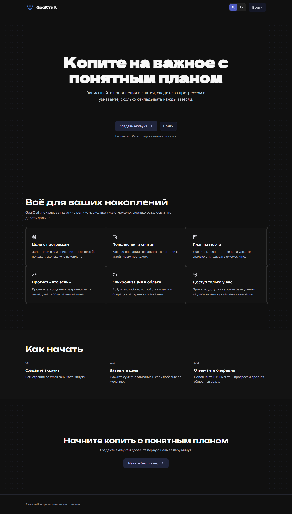
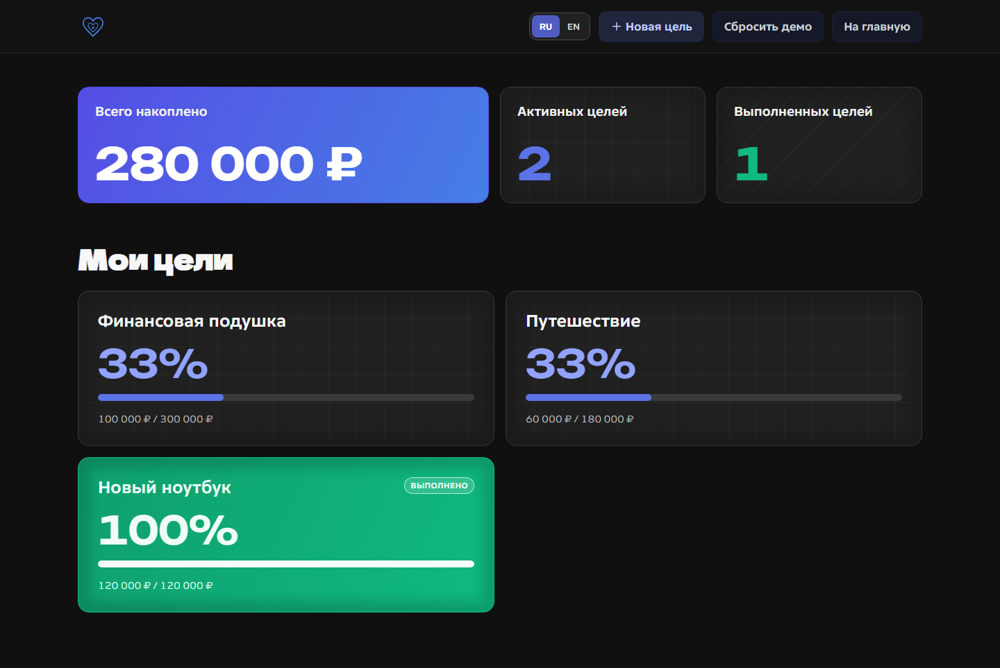
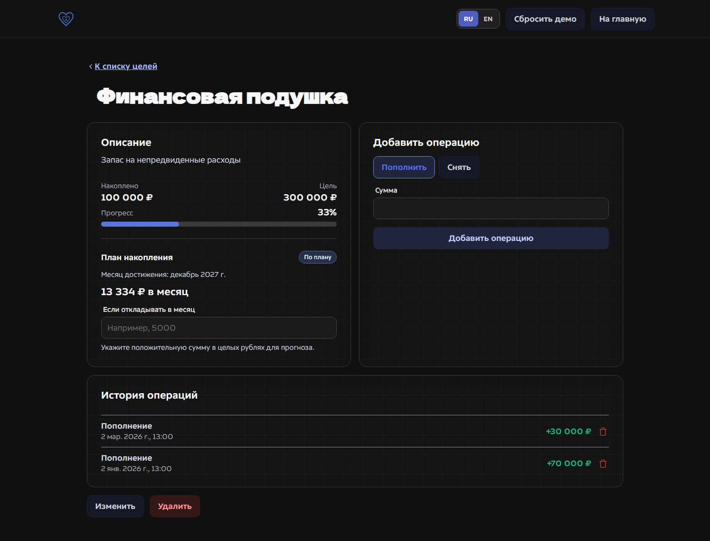
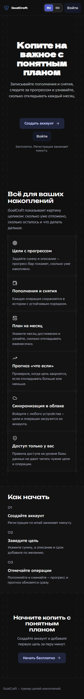
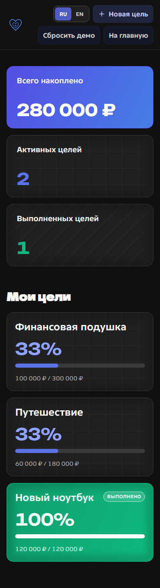
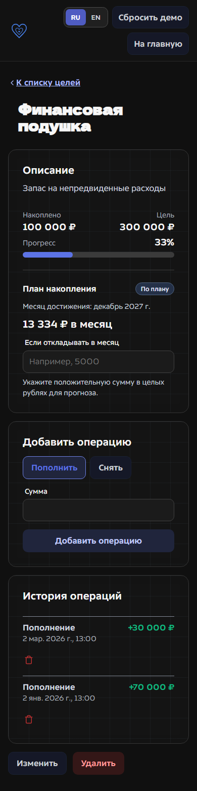

# GoalCraft

[English version](README.md)

Двуязычный трекер накоплений на React и TypeScript. Заведите аккаунт и синхронизируйте цели и операции через Supabase. Для каждой цели доступны целые рубли или доллары США.

## Скриншоты

### Компьютер







### Телефон







## Возможности

- Несколько целей, пополнения, снятия, прогресс и история операций с устойчивым порядком.
- Выбор RUB или USD у каждой цели. Итоги по валютам отображаются отдельно, без конвертации сумм.
- Необязательный месяц достижения и нужный взнос: `ceil(остаток / число месяцев от текущего до целевого включительно)`.
- Калькулятор «что если» показывает прогноз месяца завершения для выбранного взноса. Выполненные и просроченные цели отмечены отдельно.
- Офлайн-режим с примерами сохранён для браузеров, где он был выбран раньше; его данные остаются в браузере и автоматически в облако не отправляются.
- Регистрация по email и паролю, подтверждение адреса, вход и восстановление доступа через Supabase Auth. Для аккаунта источником данных служит Postgres.
- Переключатель RU/EN с сохранением выбора.

## Архитектура и компромиссы

В проекте используются React 19, TypeScript, React Router, Redux Toolkit, CSS Modules, Jest и Playwright. Общие компоненты отображают локальное демо и облачный аккаунт. Демо сохраняется в `goal-tracker-demo-state`. Старые данные из `goal-tracker-state` копируются в демо при первом входе без изменения исходной записи. Облачный Redux store не записывает журнал в браузерное хранилище: после изменения, возвращения к вкладке или восстановления сети он загружает актуальные данные из Postgres.

RLS даёт пользователю SELECT только своих строк. Прямые записи из клиента запрещены: пять серверных RPC создают, изменяют и удаляют цели, добавляют и удаляют операции. Отдельная функция `get_ledger()` читает обе таблицы одним снимком и возвращает весь журнал одним объектом. Порядок операций хранится в `position`. RPC блокирует строку цели и проверяет историю баланса; изменение `ledger_version` заставляет конкурирующую запись в `REPEATABLE READ` завершиться конфликтом вместо работы с устаревшим балансом. Клиент заранее проверяет типичные ошибки, но окончательное решение принимает сервер.

Сейчас клиент после каждого изменения загружает весь небольшой журнал заново. Это упрощает согласованность и обработку ошибок, но для очень длинной истории понадобятся страницы. Дробные суммы не поддерживаются. Локальные данные не смешиваются с облачным аккаунтом и не импортируются автоматически. Если бесплатный проект Supabase приостановлен, аккаунты временно недоступны, а статическое демо продолжает работать.

## Локальный запуск

Нужен Node.js 22.11 или новее.

```sh
npm ci
npm start
```

Откройте `http://localhost:3000`. Приложение запускается без переменных окружения; для облачного режима скопируйте `.env.example` в `.env`, укажите `SUPABASE_URL` и `SUPABASE_PUBLISHABLE_KEY` проекта Supabase с применённой миграцией, затем перезапустите webpack. Эти значения публичны и попадают в браузерную сборку. **Никогда не указывайте здесь service-role или secret key.**

Перед развёртыванием фронтенда примените все миграции, включая `20261019000100_goal_currency.sql`: она добавляет валюту и расширяет RPC целей. Старые клиенты совместимы с новыми значениями параметров по умолчанию. Существующие цели без валюты считаются рублёвыми.

```sh
npm run lint
npm run format:check
npm run typecheck
npm test -- --silent
npm run build
npm run test:e2e
```

Готовая сборка лежит в `build/`. `npm run capture:screenshots` обновляет шесть скриншотов при запущенном `npm start`. Браузерные тесты проверяют desktop, mobile, работу клавиатурой, операции в демо и экран входа. pgTAP и тесты гонок с двумя соединениями выполняются в CI; локально для них нужны Supabase CLI, Docker, Bash и `psql`.
